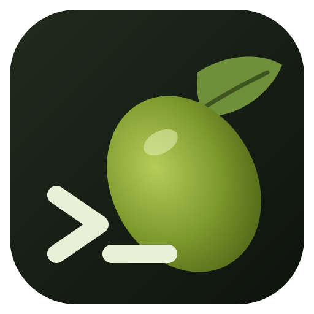
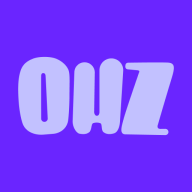
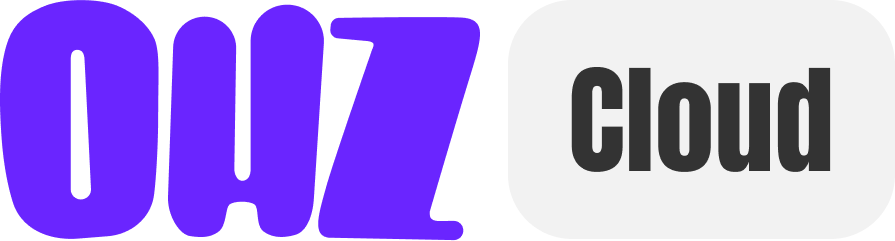

# Hi, I'm Oihalitz 👋

I build software, infrastructure and digital services from Bilbao. 
These are the projects I'm working on right now.

## Current projects

<table align="center">
<tr>
<td align="center" valign="top" width="50%">

<h3>Termoak</h3>

Cross-platform SSH client with persistent sessions.

<a href="https://termoak.com/">Website</a> · <a href="https://github.com/TermoakSSH">GitHub organization</a>
</td>
<td align="center" valign="top" width="50%">

<h3>xdp.es</h3>

Public DNS with encrypted DNS and ad blocking.

<a href="https://xdp.es/">Website</a> · <a href="https://github.com/Oihalitz/xdp-dns-evadeproxy">Repository</a>
</td>
</tr>
<tr>
<td align="center" valign="top" width="50%">

<h3>ohz.es</h3>

Fiber and mobile connectivity.

<a href="https://ohz.es/">Website</a>
</td>
<td align="center" valign="top" width="50%">

<h3>ohz.cloud</h3>

Cloud hosting and DDoS-protected infrastructure.

<a href="https://ohz.cloud/">Website</a>
</td>
</tr>
</table>

## Stack

| | |
|---|---|
| **Backend** | PHP, Laravel, Python, Flask, Rust, Node.js, GraphQL, Cython |
| **Frontend** | JavaScript, Vue.js, Tailwind CSS, Material UI, Bootstrap, HTML5, CSS3 |
| **Data** | MySQL, PostgreSQL, MongoDB, Firebase |
| **DevOps** | Linux, Bash, Docker, Kubernetes, Nginx, Grafana, Git, GitLab |
| **Mobile** | Android, Kotlin, Swift, Dart |
| **CMS** | WordPress, WooCommerce |
| **AI and hardware** | TensorFlow, Arduino, Raspberry Pi |
| **Design** | Figma, Blender, Illustrator, Photoshop, Premiere Pro |

## GitHub activity

<picture>
  <source media="(prefers-color-scheme: dark)" srcset="https://streak-stats.demolab.com?user=Oihalitz&theme=github-dark-blue&hide_border=true" />
  
</picture>

## Let's talk

For proposals, collaborations or to talk about a project, message me on LinkedIn.

---

<i>Todo es posible hasta que lo intentas</i> 💪🏻 · <a href="https://oihalitz.es/">oihalitz.es</a>
  

